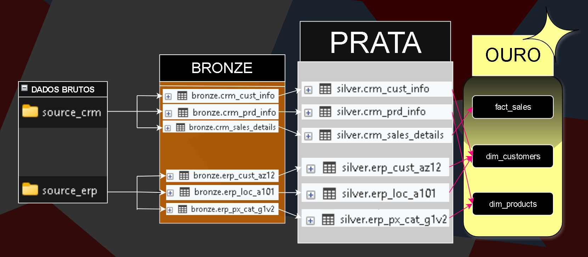

Esse projeto foi feito para fins educacionais, seguindo como referência um vídeo tutorial de [DataWithbaara](https://www.youtube.com/@datawithbaraa)

```
Teste-em-SQL/
├── datasets/               Seis arquivos de dados utilizados
│   ├── source_crm/         Pasta dos três arquivos de CRM
│   └── source_erp/         Pasta dos três arquivos de ERP
├── 02_docs/                Pasta que contém a documentação ( só tem uma unica imagem na verdade )
├── 03_scripts/             Pasta dos scripts para rodar o projeto
│   ├── init_database.sql   Isso aqui inicializa o banco de dados
│   ├── bronze/             Camada que carrega os dados brutos ( tem que ser a primeira )
│   ├── prata/              Camada que limpa e prepara os dados ( tem que ser a segunda )
│   └── ourogold/           Camada que prepara tabelas com os dados limpos para análise ( tem que ser a ultima )
└── 04_tests/               Pasta de testes para as camadas prata e ouro
```
Os dados são lidos de pastas cujos endereços estão no download do meu computador, então se for utilizar por favor mudar o endereço senão não vai funcionar...

## Fluxo dos Dados:



### Camada Bronze: Pega os dados brutos ( CRM e ERP ) e os armazena no servidor SQL.
### Camada Prata: Aqui ocorrem processos de limpeza, padronização e normalização dos dados para que eles sejam analisados posteriormente.
### Camada Ouro: Os dados armazenados já estão prontos para serem analisados e são colocados em um schema especial. 

